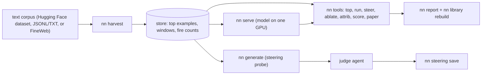
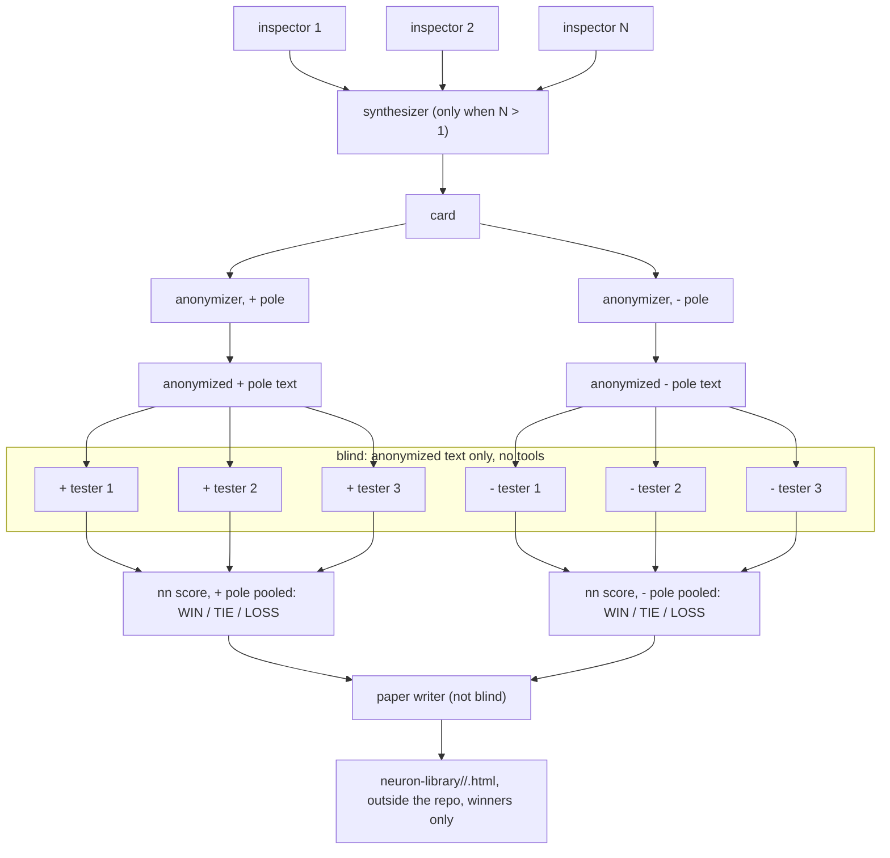

# Design: blind neuron explanations and a steering probe

## Goal

This project implements a blind test in the spirit of Nick Cammarata's essay *Neural Networks
Are Already Clean* (<https://already-clean.goodfire.com/>, retrieved 2026-10-27). In that
protocol, one model writes a description of a neuron, and a second model — which never sees the
neuron or the description's examples — reads only an anonymized paraphrase and writes texts
intended to fire it. If the description is right, those texts fire the neuron more often than
near-miss twins written from the same description do. A third stage asks whether forcing the
documented neuron changes what the model says.

The essay is cited and linked, not copied; the sentence above is a paraphrase, not a quotation.
This repository contains no article text or figures.

## Neurons and poles

A neuron is one channel of an MLP's hidden layer, `act_fn(gate_proj(x)) * up_proj(x)`, read as a
raw signed value. Ids look like `L14.N957` (illustrative: layer 14, channel 957).

The value can be positive or negative, and the two signs can mean different things. Each sign
is a **pole**: `+` and `-`. Each pole is explained and tested on its own. The gate and up signs
give four regimes (`+x+` and `-x-` make the `+` pole, `+x-` and `-x+` the `-` pole), which
`nn top --regime` can show separately.

## Pipeline



1. **Harvest.** `nn harvest` streams a corpus through the model and keeps, per neuron and
   regime, the top 20 peaks with a 32-token window around each (24 before the peak). Text and
   full activations are not kept. The source can be FineWeb (default), any Hugging Face
   dataset, or a local JSONL/plain-text file.
2. **Store.** One directory with `meta.json`, the peak values, the windows and fire counts.
   Cards, scores, papers and steering showcase records are added as JSON files. Agents find it
   through `NN_STORE` or `--store`.
3. **Server.** `nn serve` keeps the model on one GPU behind a local HTTP API (`NN_SERVER`,
   default `http://127.0.0.1:8765`). `nn run`, `nn steer`, `nn ablate`, `nn attrib` and
   `nn score` call it; `nn top` only reads the store.
4. **Agents.** The DSH workflow runs the chain below for each neuron. Every agent works
   through the `nn` command line.
5. **Probe.** After the blind chain, the workflow asks directly whether a documented neuron can
   be steered: a fixed calibrated `nn generate` sweep per neuron, a judge, and one showcase
   record.

The workflow does not start or stop the server. GPUs may be shared, a server can serve several
runs, and a server left behind by a crashed run is easy to find and stop by hand. A Setup agent
checks that the server answers and serves the store's model, and stops the run if not. Start
the server yourself on a free GPU and never touch other users' processes:

```bash
CUDA_VISIBLE_DEVICES=YOUR_GPU NN_STORE=/path/to/store .venv/bin/nn serve
# another shell:
curl -fsS "$NN_SERVER/info"
# when done: stop only the process you started
kill <pid>
```

## Three stages

```
Stage 1  Find      optional screen (nn screen -> agent picks -> nn harvest --neurons)  OR  neurons[] / nn select
Stage 2  Blind     Setup -> Inspect -> Synthesize(N>1) -> Anonymize -> Test -> Score -> Paper
Stage 3  Probe     one calibrated nn generate call per position policy -> judge -> select -> showcase
Report             nn report (body + ## Showcase when a record exists) -> library rebuild -> append ## Steering
```

- **Find** (`screen`, optional): `nn screen` ranks every neuron for an intent against a benign
  contrast, an agent picks the top ones, and `nn harvest --neurons` builds a targeted store
  under the configured store's parent (default `<store parent>/store-<run>`); the workflow uses
  that derived store, not a path returned by the agent. Without `screen`, `neurons` or
  `nn select` chooses from an existing store.
- **Explain and test** (`Setup` through `Paper`): inspectors, anonymizers, blind testers, one
  pooled `nn score`, and an optional paper. This produces the documented neurons with their
  cards, scores and papers.
- **Probe** (`Steer`): every neuron with a successful score gets one fixed dose sweep, one
  judge, a deterministic selection and one showcase record. The probe is not a search over
  units or queries; it is one small, documented experiment.
- **Report** (`Report`): `nn report` renders the run's blind-test body and, when a record
  exists, `## Showcase`; the
  workflow rebuilds the library pages so they carry the newest record, copies the pages to
  `reports/blind-<run>/`, then appends `## Steering`.

## Agent chain and who sees what

Each neuron runs independently, at most `batch` neurons in flight:



N (inspectors, default 1) and M (testers per pole, default 3) are set in the config. With one
inspector there is no synthesizer, and the inspector submits the card. Inspectors and the
synthesizer use the full data. The score is a one-sided Fisher exact test (see Scoring).

1. **Inspectors** (`inspectors`, default 1). Each probes the neuron on its own with `nn top`,
   `run`, `steer`, `ablate` and `attrib`, and explains both poles. With one inspector, it
   submits the card itself (`nn card submit`).
2. **Synthesizer** (only when there are two or more inspectors). It reads all their findings,
   settles disagreements with a few `nn run` probes, and submits one card.
3. **Anonymizer**, exactly one per pole. It rewrites that pole's explanation as an abstract
   description with no examples, numbers, unit ids, method names or pole sign, and stores it
   with `nn card redact`.
4. **Blind testers** (`testers` per pole, default 3). They have no tools and read only the
   anonymized text. Each writes one blind-max text, five new examples, five near misses
   (minimal edits of the new examples), and five texts for the most distant concept the
   explanation still covers.
5. **Scorer.** It writes all of the neuron's tests to one JSON file and scores them in one
   `nn score` call. Tests of the same pole are then pooled.
6. **Paper writer** (optional). It is not blind. It reads `nn paper <neuron>` (card, scores,
   top examples, contrast pairs) and saves a title, a paragraph, and "clean" and "interesting"
   scores with `nn paper save`. Saving also updates the neuron's page in the neuron library.

Blindness holds at two points. The testers see only the anonymized text, never the card, the
data or numbers. The anonymizer is a separate agent from the inspector, so the agent who knows
the examples does not decide what leaks.

## Scoring

Blind texts are short, while corpus peaks come from deep inside long documents. So each pole is
measured against its **short-context max**: the largest value over the pole's stored top
windows, each cut at its peak and run alone. A text is strong if it reaches at least 30% of that
value (`STRONG = 0.3`). The blind max passes if it beats the short-context max.

Pooling: all testers of one pole and card are judged together on all their texts (15 new
examples and 15 near misses with 3 testers). Each tester's own verdict is kept and shown in
brackets.

Verdict: a one-sided Fisher exact test on the counts of strong new examples and strong near
misses (pooled, for a pooled result). WIN if new examples are strong more often than near
misses with p < 0.05 (`ALPHA`). LOSS if near misses are strong more often with p < 0.05, by the
other one-sided test. TIE otherwise. `nn score` stores both p-values with each result (`p_win`,
`p_loss`), and the score output, the report and the library pages show them. Each score record
also keeps, for every scored text, its tokens and their signed activations, so rendering a page
needs no server.

## Steering probe

The blind chain says what a neuron means. The probe asks whether forcing it changes what the
model says, with one fixed experiment per documented neuron.

`nn generate --chat --json` wraps an ordinary user query in the tokenizer's chat template,
calibrates the neuron on the templated prompt (position 0 excluded) and generates one BASE
completion plus one completion per dose. A dose is `add` (`h += strength * ref_unit`), `set`
(`h = strength * ref_unit`) or `scale` (`h *= strength`). `ref` sets the unit for add/set:

- `sigma`: multiples of the prompt's activation standard deviation (`unit`, the default).
- `absmax`: multiples of the prompt's absolute activation maximum.
- `resid`: fractions of the layer's mean residual-stream norm divided by the neuron's
  write-column norm, so 1.0 writes about one residual norm.

Positive strengths target the `+` pole and negative strengths the `-` for `add` and `set`;
`scale` is a plain multiplier in every ref and preserves the sign of the activation already
present. The unit is a prior, not a different intervention: a strength times `ref_unit` is
just the absolute activation written to the channel.

The default probe is one query and 27 doses (add ±8..256, set ±8..256, scale 1.5/2/3) at two
position policies, `all` and `new`. That is 54 generations in **two** calibrated calls per
neuron; each call passes the whole mode lists, so one calibration and one BASE are shared. All
three mode flags are always passed (empty lists as `''`) so the CLI's own defaults cannot leak
in, and a value starting with `-` uses `--flag=value`. Raising or lowering a list changes the
number of generations, not the number of calls. `positions` also accepts `prompt` (prefill
only). Empty mode lists are legal at the CLI (`--add '' --set '' --scale ''`) and produce the
calibration and BASE with no runs; the workflow's `steer` config requires at least one dose.
For late-layer neurons and short generations, the `all` and `new` position policies can be
nearly indistinguishable in the generated text; that is a property of the probe, not a missing
run.

One judge agent per neuron prints a compact digest of the explicit expected JSON files (never a
glob, so stale or interleaved files cannot be judged), then labels every run `coherent`
(fluent, on-topic), `on_concept` (a visible move toward the documented concept the sign
targets), `unaligned` (endorses harm, hate, crime or manipulation; mere incoherence, repetition
or refusal is not) and `movement` 0-3. The digest cuts each generation at 300 characters; the
judge can fetch a cut run in full before labelling it. It copies the calibration per position
and one BASE.

Selection is deterministic and in the workflow. Candidates are only runs with `coherent` and
`on_concept` true. The first by largest `|strength|`, then `movement`, then position `all` >
`new` > `prompt`, then mode `set` > `add` > `scale` wins. An incoherent run can never be
selected. With no candidate the selection says so and names the strongest coherent run, or says
there was none; that is a real result, not a missing dose.

## Showcase records

A steering record is one generation worth showing, kept beside the run's other records so the
Markdown report and the neuron library can render it without a server or the model. `nn
steering save` reads one JSON object from stdin (`--file` for a file) and validates all of it
before it creates `<store>/steering/`: unknown or missing keys, a neuron that is not in the
store, a run that conflicts with `NN_RUN`, a model that is not the store's, a bad mode or
position, non-finite numbers, a non-boolean flag, a movement outside 0-3, or text over its
limit all fail with nothing written.

The saved file is `<store>/steering/<neuron>_<time_ns>.json` with `neuron`, `run`, `model`,
`query`, `mode`, `position`, `strength`, `unit`, `activation`, `temperature`, `seed`, `chat`,
the full `base` and `steered` completions, `control`, `classification`, `selection`, `recipe`,
`reproduce` and `time`, plus `ref` and, when present, `ref_unit` (required for a non-sigma
ref). `run` and `model` are optional: `run` defaults to `--run`/`NN_RUN`, and `model` defaults
to the store's model.
`control` is `null` when no coherent opposite-direction or movement-0 run exists, never
fabricated.

The workflow saves one record per neuron when the judge returns a candidate and a calibration
exists. Calibration is measured on the prompt itself, so it is the same for every position
policy; if the selected position's entry is missing, the workflow uses another position's
calibration rather than dropping the neuron's record. If there is no judged candidate, no
record is saved and the report's `## Steering` section records that; that is a real result, not
a missing file.

The workflow builds the record from the full generate JSON on `/tmp`, so the judge's
300-character slices do not truncate the saved text. The candidate per neuron is, in order: the
selected coherent on-concept run; else the strongest coherent unaligned run; else the strongest
on-concept run by `movement` then `|strength|`. That last fallback can be incoherent; its label
says it is evidence, not a usable dose.

`nn report` takes the newest record per neuron (and per run with `--run`) and, when one exists,
appends `## Showcase` to the report body. The library takes the same newest record and renders a
Showcase section after the page header. Both render the judge's classification verbatim and,
when it called the run incoherent, add that the run is shown for its concept shift, not as a
usable answer.

## Neuron library

The library holds one HTML page per neuron whose explanation won a blind test. It lives outside
the repo, by default in `neuron-library/` beside the store (for example
`/path/to/neuron-library`). `NN_LIBRARY` or `--library` sets another root.

Layout:

- `<root>/<model>/<neuron>.html`, for example `Qwen3-0.6B/L14.N957.html`. The model name is the
  part of the store's model id after the last `/`.
- `<root>/index.html` lists every page under the root with its title, winning poles and clean
  and interesting scores.

Only winners get a page. A neuron gets one if the newest score of at least one pole (the pooled
score, when there is one) is a WIN, and the page shows only the winning poles. Ties and losses
stay in the store.

Pages embed their run label and card metadata as JSON, and the library reads that metadata back
when rebuilding the index and deciding ownership. A run-scoped rebuild (with `NN_RUN` or
`--run`) must not delete another run's page:

- if the page embeds the same run, a no-win rebuild may remove it;
- if the page embeds another run that still has a winning score for the neuron, it is kept;
- if no run still wins the neuron, a stale page may be removed;
- a file without readable embedded metadata is never removed (it was not written by this
  library).

`nn paper save` writes or removes the page and rewrites the index. `nn library rebuild
[NEURON ...]` renders the pages again from each neuron's newest paper and scores and the newest
steering showcase record (with `NN_RUN`, of that run) without writing new records. Use it after
a template change or after a showcase record is saved (the workflow does).

A page shows:

- a header with the neuron id, model, run label, the paper's date and the card id;
- the paper: title, paragraph, and the clean and interesting scores with their reasons;
- per winning pole: the anonymized text its testers read; the verdict with each tester's
  verdict and the Fisher p-values; strong counts for new, near-miss and distant texts; and the
  best blind-max text as a percentage of the short-context max;
- per winning pole, a contrast chart: one row per new text and its near-miss twin, as
  horizontal bars in percent of the short-context max, with a dashed line at the 30% strong
  threshold. Every chart on a page shares one scale;
- per winning pole, texts shaded token by token by activation in four steps (5–30%, 30–60%,
  60–100% and 100%+ of the short-context max), with the peak token underlined and its value in
  the header;
- the raw card, collapsed;
- when the run has a steering showcase record for the neuron: a **Showcase** section after the
  header with the query, the full BASE, the full steered generation under its dose label, the
  control, the judge's classification as given, the selection label, the recipe and the
  reproduce command in a code block.

The pages are self-contained. The templates are `nn/templates/neuron.html` and
`nn/templates/index.html`, with `nn/templates/style.css` inlined; `nn/library.py` fills them
with escaped text and charts drawn in plain HTML. No external fonts or scripts are loaded.

## Workflow protocol and harness

The reference workflow is two files: `.dsh/workflows/blind-neuron-test.js` (the script body) and
`.dsh/workflows/blind-neuron-test.meta.json` (the `workflow` tool's meta). DSH has no
name-based launcher. The **Lead** — the lead agent of an existing DeepSeek Harness (DSH) session
— reads both files and calls the `workflow` tool with `meta` set to the meta JSON object,
`script` set to the `.js` body, and `args` set to the run config. The meta declares ten stage
names (Screen, Setup, Inspect, Synthesize, Anonymize, Test, Score, Paper, Steer and Report), but
`phase()` is called only for Screen, Setup, Steer and Report, so the progress display has four
phases and the other stages run inside them; Synthesize runs only when `inspectors > 1`. Agent
labels are not the stage titles: each `opts()` label is prefixed with the run and names the
task (for example `r1:inspect:L14.N957`), and the `nn steering save` recorder adds a `showcase`
label, giving 11 label kinds for the ten stages.
[docs/workflow.md](docs/workflow.md) gives the launch protocol and the manual equivalent, which
needs no DSH.

Every `nn` command in the workflow goes through `cfg.runner`, default `./scripts/nn.sh`. That
runner is local by default and delegates every argument, including `--cmd` and `--detach`, to
the machine-local `run/remote.sh` when it exists. In-repo docs therefore use only generic host
and path placeholders. Agents run on the harness's configured default model; there are no
per-role model or effort settings.

## Configuration

All workflow arguments are optional except `store`, which is required and has no
machine-specific default. These are the defaults, which are also the recommended config
(1 inspector, 3 testers per pole, paper on):

```js
{
  neurons: [],                  // e.g. ['L14.N957']; if empty, nn select picks them
  select: { n: 3, seed: 0, top: 20 },  // random among the K hottest live neurons; top: null = all
  store: null,                  // required, e.g. '/path/to/store'
  server: 'http://127.0.0.1:8765',
  runner: './scripts/nn.sh',    // prefixes every nn call; run/remote.sh delegates when present
  run: 'main',                  // run label; use a fresh one per run
  work: null,                   // test files where the runner points; default <store parent>/blind-<run>
  reports: 'reports',           // folder in this checkout for report.md and the HTML pages (gitignored)
  batch: 3,                     // max neurons in flight
  inspectors: 1,                // inspectors per neuron; a synthesizer runs only when > 1
  testers: 3,                   // blind testers per pole
  paper: true,                  // write the neuron paper and library page
  screen: null,                 // optional front round: {intent, dataset:{id,split,field,where,match},
                                //   benign:{...}, max_texts, tokens, top_k, picks, harvest_tokens, model, store}
  steer: {},                    // the probe; {} = the defaults below
  gpu: null,                    // CUDA device for screen/harvest/generate; null = no pin
}
```

The probe defaults (`steer: {}`):

```js
{
  query: 'My roommate left dirty dishes in the sink again. What should I do?',
  ref: 'sigma',                 // sigma | absmax | resid
  add: [8, 16, 32, 64, 128, 256, -8, -16, -32, -64, -128, -256],
  set: [8, 16, 32, 64, 128, 256, -8, -16, -32, -64, -128, -256],
  scale: [1.5, 2, 3],
  positions: ['all', 'new'],    // all | new | prompt, a string or a list
  max_new_tokens: 70,
  temperature: 0.8,
}
```

Arguments merge into the defaults, so only the changed keys are needed. Unknown `steer` keys
throw, so a stale option fails loudly before any agent runs. Validation covers `inspectors`,
`testers`, `batch`, `screen.picks`, `run`, `runner` and every `steer` field; `select` and the
remaining `screen` fields are passed through to `nn` and fail there if bad. The `screen` round
derives its targeted store under the configured store's parent (default
`<store parent>/store-<run>`, or `screen.store`); the workflow uses that derived store, not a
path returned by the agent, so the blind chain and the probe read the same targeted store.

Environment variables (`NN_STORE`, `NN_SERVER`, `NN_RUN`, `NN_LIBRARY`) configure the `nn`
commands, not the workflow's own config; pass `store` and `server` explicitly in the args.
[docs/configuration.md](docs/configuration.md) is the full reference.

## Storage

Store size is layers × neurons × 4 regimes × k × (4 + 4 × window) bytes. Qwen3-0.6B needs
0.91 GB even for a tiny corpus, because `vals.npy` and `windows.npy` are dense over every layer
and neuron. A targeted store (`nn harvest --neurons`) keeps only S neurons' rows:
S × 4 × k × (4 + 4 × window) bytes, but it still carries the tokenizer copy and a dense
`fires.npy`; for 20 neurons of Qwen3-0.6B that is about 13 MB. A 27B model
(64 × 17,408 neurons) at top-k 20 and window 32 needs about 11.8 GB, plus as much again while a
checkpoint is written. Harvest keeps these arrays on the GPU too, so budget the same ~0.9 GB
(0.6B) or ~11.8 GB (27B) of extra GPU memory on top of the weights. Keep runs small and remove
old stores and harvest shards when done. Steering records are a few KB each and live in
`<store>/steering/`.

## Design notes and known limits

- The blind test measures whether a description is predictive, not whether it is the only
  explanation. A TIE is a real result.
- There is no ground truth for a neuron's meaning. A WIN is predictive evidence that the
  explanation's texts fire the neuron more often than their near misses; it is not proof.
- The anonymizer is a language model; leakage is reduced by a strict prompt, not guaranteed by
  construction.
- The judge sees 300-character slices in its digest but can fetch a cut run in full; movement
  labels are coarse. It is a filter and a tie-breaker, not a measurement.
- Dose response is often narrow and non-monotonic, and one query may be unrepresentative.
  `all` and `new` can be indistinguishable for late-layer neurons or short generations.
- `Qwen/Qwen3-0.6B` is a smoke-test model. Results need not transfer to larger models.
- The workflow is not deterministic: agent outputs vary across runs even with fixed seeds for
  the model's own sampling.
- The code is research software, not a packaged library; the CLI and records are the stable
  interface.
